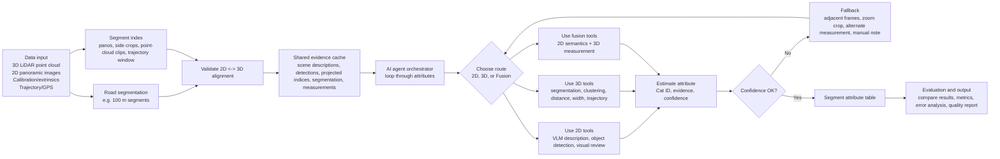
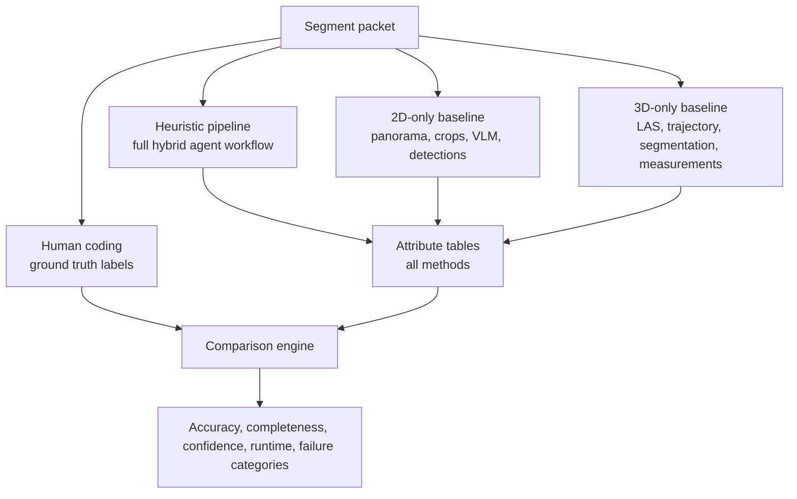

# System Pipeline Blueprint

Use this reference to create a whole-system flowchart or architecture diagram for the iRAP multiagent workflow.

## Architecture Crux

The system is a hybrid agent orchestrator that loops through road segments and selected iRAP attributes. It uses shared preprocessing once, routes each attribute to 2D, 3D, or fusion tools, applies attribute-specific coding rules, records confidence and evidence, and compares multiple method branches against human ground truth.

## Top-Level Flow



## Method Comparison Flow



## Agent-Orchestrator Pseudocode

```text
for segment in dataset:
  build segment_packet
  validate alignment and required inputs
  populate shared_evidence_cache

  for method in [heuristic_pipeline, 2d_only, 3d_only]:
    for attribute in selected_attributes:
      route = choose_tool_route(attribute, method, available_evidence)
      intermediate = run_or_collect_evidence(route, segment_packet)
      result = apply_attribute_coder(attribute, intermediate)
      if confidence_low(result):
        result = run_fallback(attribute, method, segment_packet, result)
      write result to segment_attribute_table

compare segment_attribute_table with human_ground_truth
write metrics, error analysis, and paper-ready outputs
```

## Flowchart Layout Guidance

- Use a left-to-right layout for architecture diagrams and top-to-bottom layout for experiment comparison diagrams.
- Put raw data inputs on the left/top.
- Put shared preprocessing before method branches to avoid implying repeated work.
- Use a diamond for route selection and confidence checks.
- Use separate color or grouping for 2D tools, 3D tools, fusion tools, and outputs.
- Keep ground truth visually separate from prediction branches to avoid leakage.
- End with tangible artifacts: segment attribute table, metrics table, error-analysis table, and report.

## Diagram Blocks To Include

1. Data input: 3D LiDAR, 2D panoramas, calibration/extrinsics, trajectory/GPS.
2. Preprocessing: road segmentation, segment index, pano/point-cloud clips, 2D/3D alignment validation.
3. Toolbox modules: 2D tools, 3D tools, fusion tools.
4. Agent orchestrator: loop through attributes, choose route, estimate attribute, confidence gate.
5. Method comparison: human coding, heuristic pipeline, 2D-only baseline, 3D-only baseline.
6. Outputs: attribute tables, comparison metrics, failure analysis, quality/efficiency report.

## Optional Visual Reference

If `assets/system_pipeline_reference.png` exists in this skill folder, use it only as a conceptual layout reference. Do not depend on the image path when producing a text-only workflow; the Mermaid templates above are the canonical reusable representation.
